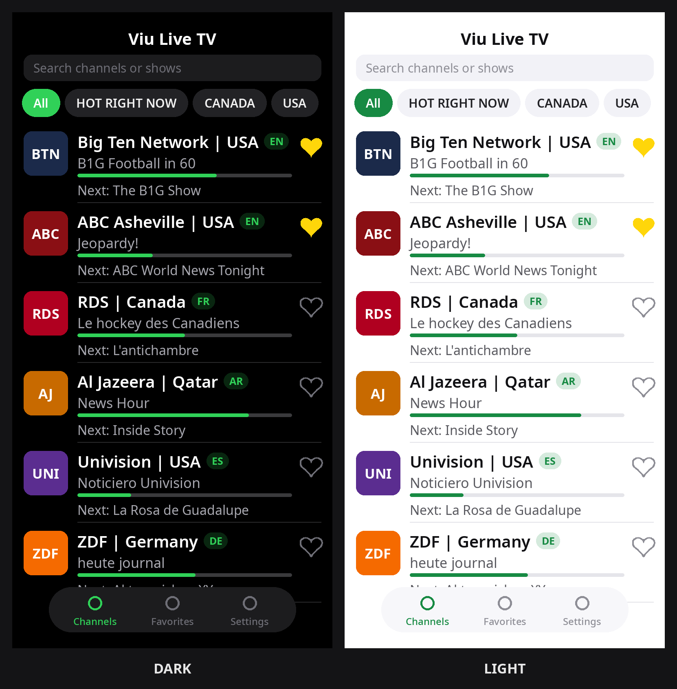
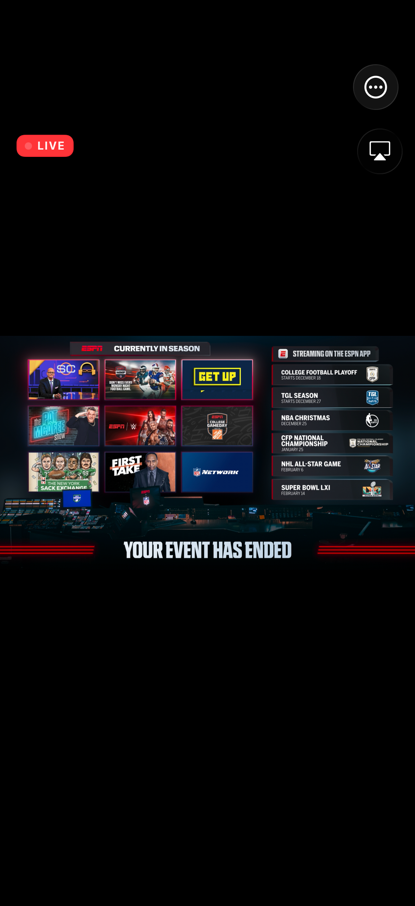
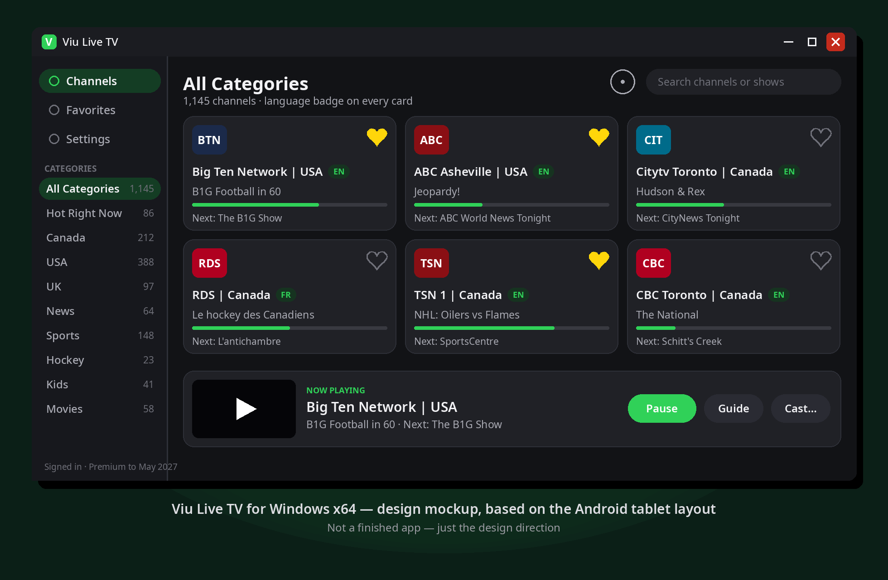

# Viu Live TV

**Live TV for Viu members, on every screen you own** | iPhone · iPad · Apple TV · Mac · Android · Android TV · Windows

An unofficial, personal-use live TV client for [Viu](https://viu.to) subscribers. Sign in with your Viu account and watch your live channels with a fast native guide, favorites that sync with your account, and a proper big-screen experience on TV and desktop. Live TV only: no movies, no series, no video on demand. An active Viu VIP subscription is required.

> This is an unofficial hobby project. It is not affiliated with or endorsed by Viu. You need your own Viu account and subscription; the app never sees or stores your password anywhere except the sign-in request to Viu itself.

## Screenshots

| iOS home | Playback | Windows |
|---|---|---|
|  |  |  |

## Download

Grab the newest build for your platform from the **[latest release](https://github.com/c12n/viu-live-tv/releases/latest)**. One release carries every platform:

| Platform | File | Install |
|---|---|---|
| iPhone / iPad | `ViuLiveTV-iOS-v*.ipa` | Sideload with Feather, AltStore, SideStore or Sideloadly, or use TestFlight (internal testers) |
| Apple TV | `ViuLiveTV-AppleTV-v*.ipa` | TestFlight (internal testers) |
| Mac | `ViuLiveTV-macOS-v*.zip` | Unzip and run the app |
| Android phone / tablet | `ViuLiveTV-Android-v*.apk` | Sideload the APK (universal build works everywhere) |
| Android TV | `ViuLiveTV-AndroidTV-v*.apk` | Sideload the APK |
| Windows | `ViuLiveTV-Windows-v*-x64.zip` | Unzip and run |

**Feather / AltStore / SideStore:** add this app's own source and updates arrive on their own:
`https://raw.githubusercontent.com/c12n/viu-live-tv/main/altstore/source.json`

## Features

| | |
|---|---|
| **Live guide** | Full channel list with now and next programmes, progress bars and end times, category chips from your account (70 plus categories), channel logos, search by channel or by what is on, and pull to refresh. The guide is cached, so the app opens instantly. |
| **Timeline guide grid** | A TV-style grid of the next 6 hours. Tap any programme for details, Play, Favorite and Remind Me. |
| **Native player** | Apple platforms use AVPlayer with AirPlay, Picture in Picture and background audio. Android and Windows use mpv. Auto-reconnect with a stream health indicator, subtitle and audio track picker, sleep timer, audio-only mode, and open-in-external-player (VLC, Infuse, OutPlayer and more) on iOS. |
| **Chromecast** | Cast any channel to a Chromecast or Android TV from the iOS and Android apps, no third-party SDK. |
| **Multiview** | Watch up to four channels at once on iPad, Android tablets, Windows, Android TV, Apple TV and Mac. Tap a pane to hear it, expand any pane to full screen. |
| **Favorites, your way** | Favorites sync with your Viu account, and you can pin channels to the top and reorder them by dragging. |
| **Profiles** | Separate favorites, recents and groups per person. Only the main profile syncs favorites with the account; the rest stay on the device. |
| **Custom groups** | Build your own channel collections, like "Morning news" or "Race day", on top of the built-in categories. |
| **Live Sports Now** | A home rail with every sport channel that is live right now, plus a Sports Mode that turns the whole app into sports only. |
| **Jump back in** | One tap returns to the channel you were just watching, with how much of the programme is left. |
| **Remind Me** | Get a notification when a programme starts (iPhone, iPad and Android). |
| **Parental controls** | A 4-digit PIN, per-channel locks, Kids Mode that limits the app to kids channels, and a kids bedtime that locks the app until morning. |
| **Readable by design** | Larger text options including an extra-large mode, language badges on every channel with a language filter, accent colors, and light and dark modes. |
| **Everywhere layouts** | iPad split view, TV interfaces built for the remote, keyboard shortcuts on Mac and Windows, and a remote shortcuts guide on TV. |

## Requirements

| Platform | Minimum |
|---|---|
| iPhone / iPad | iOS 17.0 (Liquid Glass interface on iOS 26) |
| Apple TV | tvOS 17.0 |
| Mac | macOS 14.0 |
| Android / Android TV | Android 8.0 |
| Windows | Windows 10, 64-bit |

Plus a Viu account with an active VIP subscription.

## FAQ

**Is this affiliated with Viu?**
No. It is an unofficial client built for personal use by a subscriber. All channels and programme data come from your own Viu account.

**Where do I get a subscription?**
At [viu.to](https://viu.to). The app checks your premium status at sign-in and on every launch, and points you to the member site if it has lapsed.

**Why sideloading?**
Apps that play a single third-party service's streams need that service's permission to sit in the public App Store or Play Store, so this project ships through GitHub releases, sideloading tools and internal TestFlight instead.

**Does it work on my TV?**
Yes: there are dedicated Android TV and Apple TV builds with remote-first interfaces, and the iOS and Android apps can cast.

**Can the whole family use it?**
That is what profiles are for. Each profile keeps its own favorites, recents and groups on the device, and parental controls plus kids bedtime cover the younger viewers.

## Roadmap

| Status | Item |
|---|---|
| Shipped in 2.0.0 | Guide grid, profiles, custom groups, pinned favorites, sleep timer, track picker, auto-reconnect, kids bedtime, audio-only mode, Live Sports Now |
| Next | On-device polish from tester feedback across all six platforms |
| Exploring | Recording and catch-up, if the service ever exposes them to clients |

## How it talks to Viu

All requests use the Android app's user agent, `viutvapp/1.12 LH`.

| Purpose | Request |
|---|---|
| Login | `POST https://api.viu.rs/api/4/authenticate` with JSON `{"user": "…", "password": "…"}` returns a session token |
| Categories | `GET https://api.viu.rs/epg_tags.php?token={token}` |
| Channels and guide | `GET https://api.viu.rs/epgjson.php?token={token}&tag={tag}` (the ALL feed first, per-category merge as fallback) |
| Play a channel | `GET https://api.viu.rs/api/4/live-tv/links/{stream_id}/{token}` returns a standard HLS playlist |
| Favorite / unfavorite | `POST …/api/4/save/stream/favorite/{token}` and `POST …/api/4/remove/stream/favorite/{token}` |
| Account | `GET …/api/4/accountinfo/{token}` drives the VIP gate |

The session token lives in the Keychain on Apple platforms and in app-private storage elsewhere. Stream URLs can be plain HTTP on some channels, so the Apple apps allow arbitrary loads, the same as the official Android app.

## Building

| App | Stack | Where |
|---|---|---|
| iOS | SwiftUI, Xcode project `ViuLiveTV.xcodeproj` | `ViuLiveTV/` |
| Apple TV | SwiftUI, shares the iOS data layer | `appletv/` |
| macOS | SwiftUI, shares the iOS data layer | `macos/` |
| Android + Windows | Flutter (one codebase) | `mobile/` |
| Android TV | Flutter | `tv/` |

Every platform builds in GitHub Actions on each push; releases are assembled from those builds.

## Credits

Built by c12n Apps. Not affiliated with Viu.

Copyright (c) 2026 c12n Apps | MIT License
